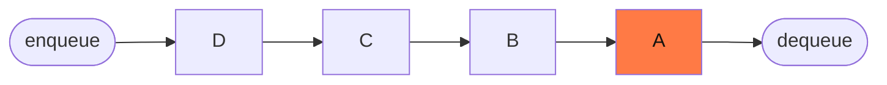
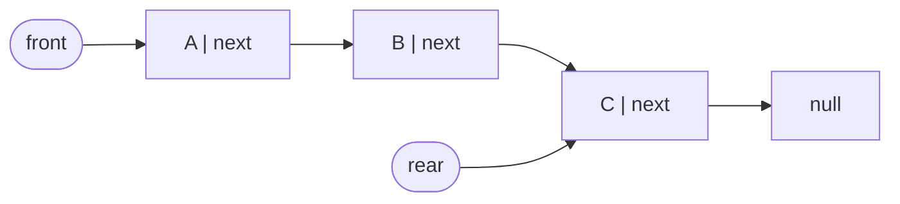

# Estructura de Datos

> **Clase:** miércoles 7:30 – 8:15 · **Lab:** viernes 8:20 – 10:45

Enlaces: [[Universidad/Universidad|Universidad]] · [[Gestión/Gestión|Gestión]] · [[Dashboard]]

## Bloc de notas

Escribe directo aquí abajo y pon la fecha antes de cada clase.

---

### 2026-10-23 — Exposiciones: colas

> **Resumen del día:** dos grupos expusieron sobre **colas**: el **Grupo #4** en **Java** y el **Grupo #2** en **C++**. También se repasaron los **arreglos** (unidimensionales y bidimensionales).

#### ¿Qué es una cola?

Una estructura **FIFO** (*First In, First Out*): el primero que entra es el primero que sale. Es como la **fila del supermercado**: llegas por atrás (**back / rear**) y te atienden por delante (**front**).



*A entró primero, así que sale primero.*

#### Operaciones básicas

| Operación | Qué hace | Java (`Queue`/`Deque`) | C++ (`std::queue`) |
| --- | --- | --- | --- |
| **enqueue** | Mete al final | `offer(x)` / `add(x)` | `push(x)` |
| **dequeue** | Saca del frente | `poll()` / `remove()` | `pop()` |
| **front** | Mira el primero sin sacarlo | `peek()` | `front()` |
| **back** | Mira el último | `peekLast()` (Deque) | `back()` |
| **isEmpty** | ¿Está vacía? | `isEmpty()` | `empty()` |
| **display** | Muestra todos | recorrer con `for` | copiar y vaciar (no hay índices) |

> **Nota:** `offer()` es de `Queue` (mete al final). `offerLast()` es de `Deque` y hace lo mismo, pero también existe `offerFirst()` para meter **por delante**.

#### Tipos de colas

| Tipo | Idea | Ejemplo |
| --- | --- | --- |
| **Simple** | FIFO sobre un arreglo | Fila del súper |
| **Circular** | El final "da la vuelta" al inicio | Buffer de audio/video |
| **Enlazada** | Nodos conectados, sin tamaño fijo | Cola de matrícula |
| **Con prioridad** | Sale primero el más importante | Urgencias de un hospital |
| **Doble extremo** (*Deque*) | Entra y sale por ambos lados | Historial atrás/adelante del navegador |

#### Colas enlazadas

> **Analogía: un tren de vagones.** Cada vagón (nodo) guarda dos cosas: la carga (**dato**) y el enganche al siguiente vagón (**next**). No necesitas saber cuántos vagones habrá: enganchas uno nuevo al final cuando llega alguien, y desenganchas el de adelante cuando sale.



- **enqueue:** creo un nodo nuevo → `rear.next = nuevo` → `rear = nuevo`.
- **dequeue:** `front = front.next` (el nodo viejo se pierde y se libera).
- **Ventaja frente al arreglo:** nunca se "llena" (solo si se acaba la memoria) y no desperdicia espacios.
- **Desventaja:** cada nodo gasta memoria extra en el puntero, y no se puede saltar directamente a la posición 5.

```java
class Nodo { int dato; Nodo next; Nodo(int d){ dato = d; } }

class ColaEnlazada {
    Nodo front, rear;
    void enqueue(int x){
        Nodo n = new Nodo(x);
        if (rear == null) { front = rear = n; return; } // estaba vacía
        rear.next = n;
        rear = n;
    }
    int dequeue(){
        int x = front.dato;
        front = front.next;
        if (front == null) rear = null;  // si quedó vacía, rear también
        return x;
    }
}
```

> **Detalle que se puede olvidar:** al sacar el último elemento hay que poner **también** `rear = null`. Si no, `rear` sigue apuntando a un nodo "fantasma".

#### Inanición (*starvation*)

En una **cola con prioridad**, si siempre llegan elementos más importantes, los de baja prioridad **nunca salen**. Se resuelve con *aging*: subirles la prioridad mientras más tiempo esperan.

---

### Arreglos

|  | Unidimensional | Bidimensional (matriz) |
| --- | --- | --- |
| Forma | Una fila de casillas | Tabla de filas × columnas |
| Acceso | `a[i]` | `m[fila][columna]` |
| Ejemplo | Notas de un estudiante | Estudiantes × calificaciones |

> **Corrección:** en mis notas escribí "primero va columna y luego fila", pero en **Java y C++ es al revés**: `m[fila][columna]`. Primero se baja a la fila y luego se avanza a la columna.

**Ejemplo:**

|  | Parcial 1 | Parcial 2 | Lab |
| --- | --- | --- | --- |
| **Ana** `[0]` | 90 | 85 | 100 |
| **Luis** `[1]` | 70 | 88 | 95 |

`notas[1][2]` → fila 1 (Luis), columna 2 (Lab) = **95**.

---

#### Grupo #2 — Colas en C++

- Ejemplo de la **impresora**: los documentos se imprimen en el orden en que llegan.
- Código de una **cafetería**: usaron un `while` con un menú para escoger opciones (encolar pedido, atender, mostrar…).

```cpp
#include <queue>   // la biblioteca para colas
#include <iostream>
using namespace std;

int main() {
    queue<string> pedidos;
    pedidos.push("Café");
    pedidos.push("Té");
    cout << pedidos.front(); // Café
    pedidos.pop();           // sale Café
    cout << pedidos.empty(); // 0 (false), todavía queda Té
}
```

---

## Preguntas de la clase (con respuesta)

**¿Por qué `front` y `rear` empiezan en `-1`?**
Porque los índices de un arreglo empiezan en `0`. El `-1` significa "no apunta a ninguna posición válida", es decir, la cola está **vacía**. Al meter el primer elemento pasan a `0`.

**¿Qué ocurre con el *overflow*? ¿Qué pasa en el sistema?**
**Overflow** = intentar meter un elemento cuando la cola (arreglo) ya está **llena**.

- **Java:** lanza `ArrayIndexOutOfBoundsException` y el programa se detiene si no se atrapa.
- **C++:** **no avisa**. Escribe fuera del arreglo y **pisa memoria vecina** (otras variables). El programa puede dar resultados raros o fallar.

> **Para ciberseguridad:** esto es el famoso **buffer overflow**, una de las vulnerabilidades más clásicas. Un atacante puede sobrescribir memoria a propósito para ejecutar su propio código. Por eso siempre se valida `isFull()` antes de `enqueue`.

Lo contrario es el **underflow**: hacer `dequeue` con la cola vacía.

**Diferencia entre cola simple y cola circular**

| Cola simple | Cola circular |
| --- | --- |
| Al sacar elementos, los espacios del inicio **quedan inútiles** | Los espacios se **reutilizan** |
| Puede decir "llena" aunque haya huecos (**falso overflow**) | Solo está llena si de verdad no hay espacio |
| `rear = rear + 1` | `rear = (rear + 1) % tamaño` |

Analogía: la simple es una fila recta donde nadie avanza; la circular es una **mesa redonda** donde el último asiento conecta con el primero.

**¿Qué es un búfer?**
Una **zona de memoria temporal** donde se guardan datos mientras esperan ser procesados. Normalmente es un arreglo (por eso se accede por **índice**) y suele funcionar como **cola circular**.

**¿Qué problema de velocidad resuelve un búfer?**
Que **dos partes trabajan a velocidades distintas**. Por ejemplo, la CPU manda páginas mucho más rápido de lo que la impresora imprime; el búfer las guarda y la impresora las toma a su ritmo. Lo mismo ocurre al ver un video: se carga un poco por adelantado para que no se corte.

**¿Cómo se llama la biblioteca de colas en C++?**
`#include <queue>` → da `std::queue` y `std::priority_queue`. Para doble extremo: `#include <deque>`.

**¿Por qué una cola en C++ no permite acceder con índices?**
Porque `std::queue` es un **adaptador**: a propósito solo expone `front`, `back`, `push` y `pop` para obligarte a respetar FIFO. Si necesitas índices, usa `std::deque` o `std::vector`, que sí tienen `[i]`.

**¿Cómo saber si una estructura está vacía?**

- Cola: `isEmpty()` (Java) / `empty()` (C++).
- Arreglo en Java: `arr.length == 0` no sirve para saber si tiene datos: un arreglo de tamaño fijo **nunca está "vacío"**, sus posiciones valen `0` o `null` por defecto. Hay que llevar un **contador** de elementos o recorrerlo.
- Vector en C++: `v.empty()`.

---

### 2026-11-13 — Listas enlazadas simples en Python

Una lista enlazada está formada por **nodos**. Cada nodo tiene dos partes: el **dato** (la información) y **siguiente** (la referencia al próximo nodo). El último nodo apunta a `None`.

La **cabeza** (*head*) es el primer nodo y es lo único que la lista recuerda: si se pierde, se pierde toda la lista.

**Lógica de funcionamiento:** no hay acceso directo por posición; siempre se empieza desde el inicio.

- **Ventajas:** tamaño dinámico; insertar o eliminar al inicio es inmediato; no necesita memoria contigua.
- **Desventajas:** no hay acceso directo por posición; usa memoria extra por las referencias; solo se recorre hacia adelante; es fácil equivocarse.

**Notación Big O:** insertar o eliminar al inicio es O(1); buscar o recorrer es O(n).

Las operaciones principales son eliminar al inicio, eliminar al final, la función valor y buscar. La búsqueda en una lista enlazada es O(n): compara cada dato con el valor buscado y devuelve la posición desde 0.

> **Recordatorio:** al leer los códigos, fijarse bien en los índices.

Recorrido: mostrar y calcular la longitud. Inversión de la lista.

**Listas enlazadas simples.** El último informe de Estructura de Datos es el viernes (listas enlazadas, del último grupo).

> [!warning] Revisar
> La fecha exacta del informe ("el viernes") no está indicada. Confirmar qué viernes es y agregarla a [[Gestión/Gestión|Gestión]].

---

## Archivos

### Material de clase

- Estructura de Datos (presentación) — PDF
- Ficha y Parámetros de Charlas Investigativas — PDF

### Tareas y entregas

- Informe de Pilas (C++) — PDF
- Actividad I E.D. — PDF
- Diagramas: árbol, diagrama de árbol de la Universidad TecnoData, diagrama de cola de matrícula, grafo, grafos y representación general de la propuesta (imágenes).

### Laboratorios

- Lab 1 — Arreglos (PDF)
- Lab 2 — Laboratorio Introductorio (PDF)

### Parciales y quizzes

Exámenes y guías de estudio. Próximo: **Parcial de Estructura de Datos, 20 de noviembre de 2026**.
